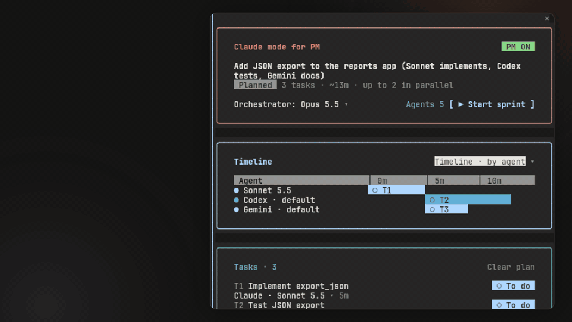

# Claude mode for PM

**Plan sprints. Delegate to agents. Ship in parallel.**

Claude mode for PM turns a Claude Code session into a project manager. Claude stays the **orchestrator**; the work goes to a team of agents. Describe what you want built and the orchestrator (Opus 5.5 by default) breaks it into short tasks, lays them out in sprints on a Gantt timeline, and hands **every task to its own agent and model**: a Claude subagent (Opus, Sonnet, Haiku) or a coding agent already on your computer, such as **Codex, Gemini, OpenCode or Grok**. You review the plan, reassign anything in one click, press **Start sprint**, and watch where every sprint stands, live. When the run ends you get one report from the orchestrator, which checks the work and re-plans whatever failed.

<p align="center">
  
</p>

<p align="center"><a href="assets/intro.mp4"><b>▶ Watch it in full quality (MP4, 20 s)</b></a> · real footage from a Claude Code session, sped up</p>

## Why

Big changes are rarely one task. They are a handful of pieces, some of which can happen at the same time, each suited to a different model. Claude mode for PM makes that structure visible and runnable:

- **See the plan before anything runs.** Every task has a concise description, an estimate, a sprint and the tasks it waits for.
- **Put the right model on each task.** Opus for hard reasoning, Sonnet for most implementation, Haiku for quick, mechanical work, or an external agent you already use.
- **Run independent work at the same time.** Tasks start as soon as what they wait for is done; sprints run one after another.
- **Keep one orchestrator in charge.** Reports come back to the session's orchestrator, which checks the work and re-plans what failed.

## How it works

1. **Describe the goal** in the normal prompt box while PM mode is on (`/pm`).
2. **The orchestrator plans it**: short tasks, estimates, sprints, dependencies, and an agent and model for each task.
3. **Review on the timeline**: click any task to open it in a dialog and change its model, estimate, sprint or dependencies; use **Assign all** to hand a whole sprint to one model.
4. **Start sprint**: Claude tasks run as Claude Code subagents, other tasks run headless in their CLI, in parallel where the plan allows.
5. **Reports return** to the orchestrator, which reviews them and plans the next sprint. Failed tasks can get another model and **Retry failed**.

## The panel

| Section | What it holds |
| --- | --- |
| **Project** | The goal and its status, the **orchestrator** picker (Opus 5.5, Sonnet 5.5 or Haiku 5.5), **Agents**, and **Start sprint**, which becomes **Stop** while running and **Retry failed** after failures. |
| **Timeline** | A Jira-style Gantt chart grouped by sprint or by agent, or a **Board** with To do / Running / Done / Failed columns. Bars wear their model's color until they finish, then green, red or grey. |
| **Tasks** | One line per task with its status and a model picker. |
| **Task dialog** | Opens when you click a task: Assignment, Schedule, Description and Result sections, with previous / next task links. |
| **Agents** | The agent CLIs found on this computer and their models, sign-in for each (browser, device code or API key), and whether external agents may only edit files or run anything. |

Everything uses the app's own theme colors, so it follows light and dark mode.

## Agents and models

- **Claude Code subagents**: Opus 5.5, Sonnet 5.5, Haiku 5.5, and any subagent type in `~/.claude/agents` or the project's `.claude/agents`.
- **Codex**, **Gemini**, **OpenCode** and **Grok**: detected automatically when installed, with the models each one lists. Tasks given to them run headless in the current working directory.

## Commands

| Command | What it does |
| --- | --- |
| `/pm` | Turns PM mode on and opens the panel. |
| `/pm <goal>` | Turns PM mode on and starts planning that goal. |
| `/pm agents` | Shows the agents on this computer and their sign-in state. |
| `/pm off` | Turns PM mode off; the plan stays on the board. |
| `/pm clear` | Removes the plan. |

## Install

At the prompt of a terminal session:

```
/plugin install pm-mode --marketplace GrzeskoByte/claude-for-PM
```

From a shell:

```bash
claude plugin install pm-mode --marketplace GrzeskoByte/claude-for-PM
```

In the desktop app, where `/plugin` does not run: click **+** next to the prompt box, then **Plugins**, **Add marketplace** with `GrzeskoByte/claude-for-PM`, then **Add plugin**.

Answer `y` to add the marketplace, then pick the user scope so the mod is on in every session.

## The intro video is real, and its edit is code

The intro is footage of a real Claude Code session in a small demo project: Opus planned the sprint, Sonnet, Codex and Gemini did the work, Gemini's task failed and was handed to Codex, and Opus wrote the report. [`video/record.sh`](video/record.sh) saved the tmux pane with its colors twice a second; [`video/render.js`](video/render.js) redraws those frames cell by cell, cuts and speeds them up, adds captions and highlights, and pipes the frames into ffmpeg. The recordings themselves are not in the repository. To make your own (needs tmux, Node and ffmpeg; the renderer loads Noto Sans, Noto Sans Symbols and JetBrains Mono from `/usr/share/fonts`):

```bash
tmux new-session -d -s pmdemo -x 160 -y 45 claude   # then use /pm in it
video/record.sh pmdemo captures/run1                # touch captures/run1/STOP to finish
cd video && npm install && CAPTURES=../captures/run1 npm run mp4 && CAPTURES=../captures/run1 npm run gif
```

Edit `SEGMENTS` in `render.js` to pick the seconds, views and captions of each beat.
